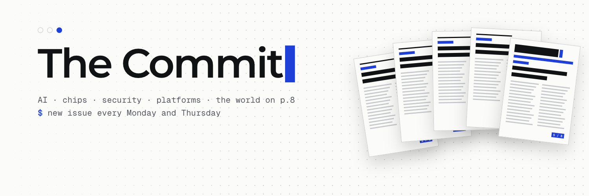
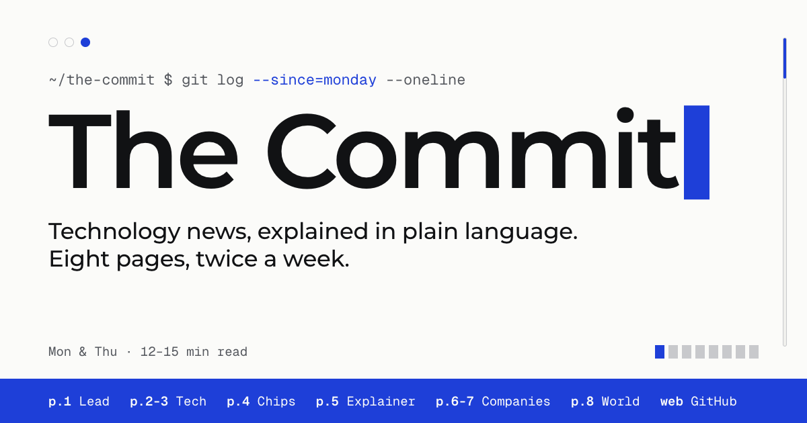
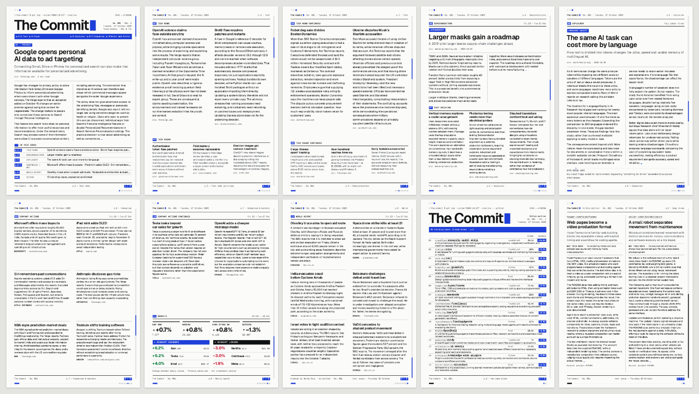
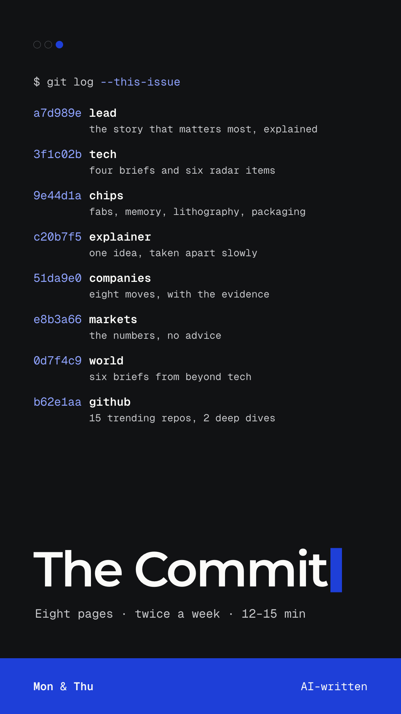
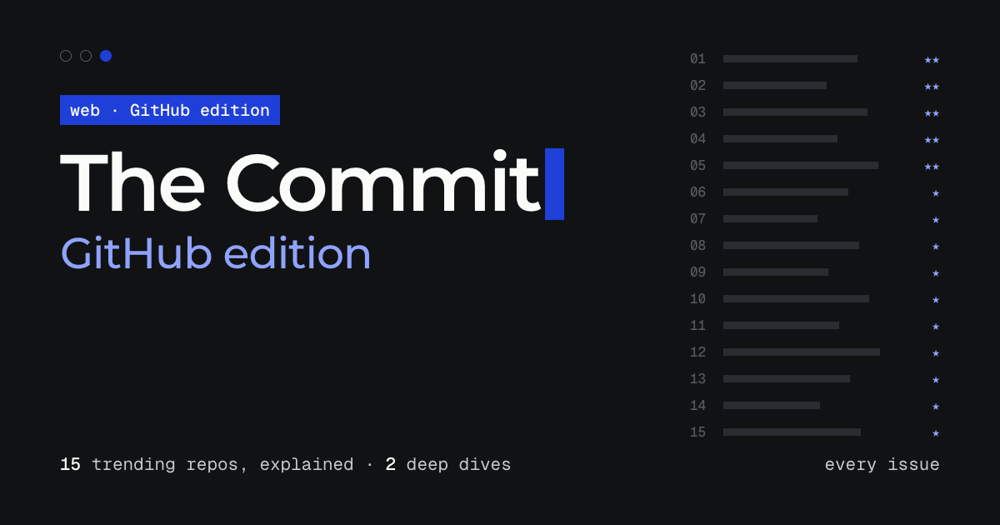

  

  <b>Technology news, explained in plain language. Eight pages, twice a week. Free.</b> 
  <a href="https://berkeokur.github.io/thecommit/"><b>Read the latest issue →</b></a>

---

## What it is

**The Commit** is a small technology newspaper that comes out every **Monday and Thursday**. Each issue is eight A4 pages: something you can read in 12 to 15 minutes, on screen or printed and folded on the kitchen table.

It covers AI, the big products and platforms, security and privacy, regulation, what companies are actually doing, and technology beyond Silicon Valley. There is a full page on **semiconductors**: memory, new factories, lithography, Chinese chipmaking, advanced packaging. The last page is a short briefing on the world outside tech.

Every issue also has a **GitHub edition**: two pages on the open-source projects people are starring this week, each explained in a sentence anyone can follow, plus two longer looks at the most interesting ones.

  

## Inside an issue

| Page | Section | What you get |
|:---:|---|---|
| 1 | **Lead** | The story that matters most, explained: what changed, the evidence, why it matters |
| 2–3 | **Tech** | Four briefs and six short radar items |
| 4 | **Chips** | Fabs, memory, lithography, packaging, and how close any of it is to real production |
| 5 | **Explainer** | One idea taken apart slowly, plus a byte-sized joke |
| 6–7 | **Companies** | Eight company moves, with the evidence, and a markets panel (numbers only, no advice) |
| 8 | **World** | Six briefs from beyond tech |
| web | **GitHub** | 15 trending repos in plain words and 2 deep dives |

  

<table>
  <tr>
    <td width="50%" valign="top">
      
    </td>
    <td width="50%" valign="top">
      
        
      <h3>The GitHub edition</h3>
      
GitHub's trending page tells you <i>what</i> is popular, but rarely what a project does or who it is for. The GitHub edition lists 15 trending repositories with their exact stars and weekly gains, each described in 14 to 20 plain words. Two of them get a closer look: what makes them different, how they work, who they help, and what their own documentation says they can't do yet.

      
Every repository name links straight to GitHub.

    </td>
  </tr>
</table>

## Why I made it

I wanted a newspaper for the technology I care about. Most tech news either assumes you already know everything or buries one real development under ten press releases. I wanted the opposite: a short paper with a beginning and an end, that tells me what actually happened, how we know, and why it matters. I also wanted it to take chips seriously, because so much of what happens in AI and computing comes down to who can build what, where, and how fast.

So I built one. It started as a personal paper I print at home twice a week, and it worked well enough that I wanted to share it.

## How it's made

The Commit is **written by AI** and says so on every issue. Behind it is a small pipeline that runs on a home server:

1. **Collect.** Scripts gather candidate stories from a fixed list of sources (Ars Technica, The Verge, The Register, MIT Technology Review, Rest of World, Krebs on Security, TrendForce, Semiconductor Engineering, EE Times, BBC, Al Jazeera, NPR and others) and the week's trending repositories.
2. **Pick.** An AI editor chooses the stories for each slot. It never browses the web itself; it only sees what was collected.
3. **Fetch.** Scripts read the chosen articles. These pages are the *only* material the writer may use.
4. **Write.** A fresh AI session writes the issue to strict word budgets, attributing company claims, forecasts and contested figures, and never inventing numbers or quotes.
5. **Check.** A validator enforces structure, word counts, dates and repository figures. A separate fact check looks for every number, quotation, version and product name in that story's own source. An issue with an unresolved flag is **held off the website** until it has been reviewed by hand.
6. **Publish.** The issue is typeset into print-ready PDFs and published here, in **English and Turkish**.

Every story links to its source, so you can always check the original.

## It's free

The Commit is **free to read**: no paywall, no sign-up, no ads, no tracking. Read it in the browser or download the PDFs and print them (A4, 100%, double-sided, flip on the long edge).

  <a href="https://berkeokur.github.io/thecommit/"><b>berkeokur.github.io/thecommit</b></a>

## About this repository

This repository holds the **published website** and is generated automatically: each new issue, fact-check approval and daily market update is pushed here by the publishing server, so changes made here directly are overwritten. Found a mistake in an issue? Please [open an issue](https://github.com/berkeokur/thecommit/issues) and link the story.

Market figures are for information only and are not investment advice.

   
  Created by Berke Okur · AI-written

